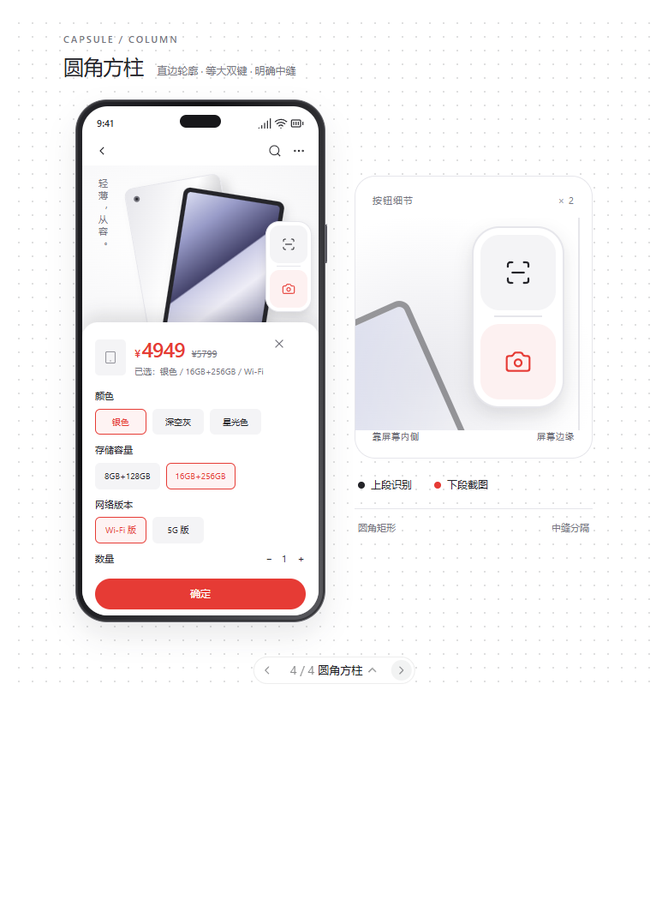

# Flash 实施说明：圆角方柱双段悬浮按钮与独立高清截图

最终整理：2026-10-17。本文是当前实现依据，替代此前两份探索文档中的实施范围：`FLASH_SKU_CAPTURE_PLAN.md`、`LOCAL_VISION_GITHUB_RESEARCH.md`。旧文档保留作背景，本期不要按其云端/本地模型、自动归纳、草稿归组等扩展要求开发。

## 一、已经确定的方向

用户要解决的问题：多配置商品在主页或详情页显示的价格，未必对应自己想买的配置；旧 OCR 对规格弹窗识别不稳定。因此，本期先让用户能在选好配置后，一键留下清晰画面，之后方便查找。

本期落实两件事：

1. 悬浮入口改为用户已选定的 **“一体双段 → 第四版：圆角方柱”**。
2. 下段按钮直接保存高清原图，放入新的独立截图记录，与原有 OCR 价格记录及附图分开。

本期不接云端接口，也不下载、集成本地大模型；不做页面自动判断、按钮自动切换、自动提取配置价或自动补齐名称。截图记录先独立可用。用户手机为 **小米 17 Ultra，16 GB 内存**，后续如确有整理需求再验证本地识图，相关调研不构成本期任务。

## 二、设计定稿

用户选的是最近一次四个“一体双段”细化方案里的 **第四版“圆角方柱”**，不是上一轮第四个“折角页签”。

参考图：



定稿特征：

- 一体、纵向、短而细的圆角矩形；上下两块大小相同的触摸区。
- 上段：浅灰底、深色扫描图标，负责原有 OCR。
- 下段：淡红底、红色相机图标，负责高清截图。
- 白色外壳、轻阴影，中间有留白和细分隔线。轮廓偏方圆，不做上下两个圆球，不做厚重立体材质或装饰。
- 图标清楚，按钮功能固定，颜色仅为辅助区分。提供对应无障碍名称。

供 Android 实现起步的尺寸（以真机触达和画面占用校准）：

| 部位 | 建议初值 |
| --- | --- |
| 单段按压区 | 44 × 44 dp |
| 外壳内边距 | 4 dp |
| 两段间隔 | 8 dp |
| 外壳圆角 | 16 dp |
| 每段圆角 | 11 dp |
| 图标 | 18 dp 左右 |
| 距屏幕边缘 | 8 dp |
| 分隔细线 | 宽约 28 dp，细线 |

外壳约 52–54 dp 宽、104–106 dp 高，具体按边框计算。浅色状态参考：白色外壳、上段 `#F4F4F6`、深色图标 `#242429`，下段约 7% 红色混白，红色图标 `#E63B35`。适配暗色外观时保持对比和功能区分，不依赖颜色辨认。

上述是设计稿起步值，不得为追求外观把两个触摸区域压到难以点击。所见边界应与点击范围一致，阴影、透明外边距和中间分隔不能触发识别或截图。

## 三、按钮行为与防误触

### 上段：保留原有识别操作

- 单击继续原来的 OCR 识别、结果编辑、保存逻辑。
- 保留原有双击轮换比价应用、长按打开拼多多等操作。
- 原有手动保存、自动保存、修改与重新识别的撤回逻辑保持正确。

### 下段：独立高清截图

- 单击立即开始截图保存，不等待 OCR，也不执行 OCR，不提取或写入商品价格。
- 不弹出选择菜单，不要求用户先切换模式。
- 成功时短暂提示“高清截图已保存”，失败时显示明确原因；不为此打开旧 OCR 结果面板。
- 不受现有“保存识别截图”开关影响。旧开关管理的是 OCR 附图，可调整文案说明，避免误以为关掉它就无法用下段截图。
- 下段不复用上段的单双击跳转动作；保存中防重复点击，避免同一次操作产生重复文件，同时允许用户保存后继续正常补拍。

### 拖动和触摸

- 拖动整组移动，贴边、位置保存、横竖屏边界处理和系统摘窗后的恢复相应适配新尺寸。
- 从任一按钮开始拖动，超过系统手势阈值后，本次手势只执行拖动；取消所有待触发点击、长按和双击任务。拖完松手不得识别、截图或跳应用。
- 手指从上段滑到下段或反向滑动，不能触发另一段的点击。
- 中间分隔和外壳空白可以用于拖动，但不能当成两个功能按钮的点击区。
- 检查父容器、子按钮与 GestureDetector 的事件分发，避免一次触摸同时触发两条回调。
- 不把矩形透明悬浮窗口中的留白当成可点按钮。对窗口空白的拦截范围也应尽量缩小，不能为了光晕额外吞掉底层拼多多操作。

## 四、截图流程与质量

```text
点击下段 → 隐藏本软件悬浮控件和面板 → 获取更新后的画面
        → 原分辨率图片写入独立目录 → 记录元数据
        → 恢复悬浮控件 → 提示保存成功
```

- 复用已有 MediaProjection 授权及前台服务，不额外启动第二个录屏会话。
- 隐藏与恢复 View 在主线程执行，图片编码与写文件放 IO 线程，保存过程不阻塞界面。
- 隐藏控件后获取新帧；处理 ImageReader 可能留有旧帧的问题，不能保存上一张画面或仍有本软件按钮的画面。等待新帧有超时上限。
- 使用截图源提供的完整原始分辨率，优先 PNG 无损保存。不套用旧截图长边 720 像素和 JPEG 质量 55 的策略。
- 原图永久保留，列表缩略图可以另行生成；不能拿缩略图覆盖原图。
- 无画面、授权失效、编码失败、磁盘不足时不能误报成功。以图片及必要元数据真正落盘为成功条件。
- 原图与元数据使用临时文件再完成归档，启动时对中断保存做恢复或清理，避免列表出现坏图。
- 成功、失败及取消都需要在 finally 中恢复界面并回收 Bitmap 等资源。
- 与 OCR 截图共用采集互斥，避免两条任务同时隐藏窗口和取帧；按键繁忙时给出简短反馈。
- 点下段不得删除或撤销上一次 OCR 自动保存记录。已有待编辑 OCR 面板如被临时隐藏，应按正常生命周期恢复，不改动其商品和价格。

## 五、独立保存与查找

第一版无需商品匹配、AI 队列、草稿会话或复杂数据库迁移。一张截图先作为一条独立记录，按时间显示；不自动把相邻截图判为同一商品。

建议使用持久 app 私有目录：

```text
filesDir/hd_captures/<uuid>/
  original.png
  metadata.json
  thumb.jpg             # 可选，仅用于列表
```

元数据至少含：schemaVersion、id、capturedAt、图片宽高、图片相对路径、来源 `manual_hd_capture`。不需要猜商品名、规格和价格。

- 与旧 `filesDir/screenshots/`、OCR 调试转储、旧价格数据库分开。
- 主界面增加明确的“高清截图”入口，打开按时间倒序的独立图片列表。
- 支持查看原图并放大、删除单张；应用重启后图片仍能找到。
- 原图查看可借鉴已有界面，但不能把新截图硬套成旧的 historyId。
- 私有目录不等于手机文件管理器可直接浏览：第一版提供“导出原图到文件”的系统文件选择器入口，保留完整 PNG。导出不需要云端。
- 删新截图只删除其原图、缩略图和元数据；删除旧 OCR 记录不应删除新截图。
- 清空功能明确区分“清空记价记录”和“清空高清截图”，不要悄悄扩大旧清空按钮的范围。
- 文件枚举、缩略图生成和图片解码均避免主线程重 I/O；列表不要逐张原尺寸解码。

## 六、现有项目接线与已知风险

项目位于 `D:\开发\pdd\PddPriceMonitor`，主包为 `com.example.pddpricemonitor`。实施前阅读适用的项目说明和 AGENTS.md，检查工作区现状。

| 位置 | 本期用途 |
| --- | --- |
| `capture/FloatingOverlayController.kt` | 新双段外形、独立点击回调、防误触、拖动及边界 |
| `capture/ScreenCaptureService.kt` | 新的纯截图入口，复用投射服务，协调互斥和提示 |
| `capture/MediaProjectionController.kt` / `ImageReaderBitmapSource.kt` | 复用画面来源，必要时处理新帧等待 |
| `data/ScreenshotStore.kt` | 旧 OCR 附图，仅参考；新原图存储应独立 |
| `capture/OcrCaptureInteractor.kt` | 旧 OCR 业务保持，不作为纯截图的前置条件 |
| `MainActivity.kt` | 增加高清截图入口，不继续堆入完整新界面实现 |
| 新的 `capture/HdCaptureInteractor.kt`、`data/HdCaptureStore.kt`、`ui/hdcapture/` | 建议按职责承载保存及新列表/详情 |

注意：

1. 目前 `OcrCaptureInteractor.captureOnce()` 只有识别出商品才触发截图回调，并会 finally 回收 Bitmap，不能用它实现“不依赖 OCR 成功的原图保存”。
2. 旧 `ScreenshotStore` 共用 `pending.jpg`，并做低分辨率压缩；新截图必须使用独立文件名和存储路径。
3. `ScreenCaptureService.captureOnce()` 涉及旧自动保存行的撤回，下段纯截图不能直接调用这个方法，也不能借用 `pendingAutoSavedHistoryId` 保存新截图。
4. 目前工作区 `data/AppDatabase.kt` 与 `data/ProductPriceHistory.kt` 有已暂存修改（包括 v8 / skuLabel 方向的工作）。保留，不回退、不覆盖；本期优先无需改旧表结构的文件归档方案。
5. 首次检查中 adb.exe 执行被环境权限阻止，尚未取得或修改手机状态。Flash 需要根据届时连接情况验证，不能把设计预览或构建成功当成真机测试通过。

## 七、验收与交付

必须验证：

- 外形符合所选“圆角方柱”；上下图标顺序正确，暗色外观可辨认。
- 点上段只识别，点下段只存图；下段操作不改变旧 OCR 记录数、价格和待确认记录。
- 原有双击/长按与自动保存、修改、重新识别仍正常。
- 拖动、边缘滑动、跨按钮移动手指不会误触功能；两个按钮各自的触摸区域不重叠。
- 原图保存尺寸与截图源一致，无本软件悬浮按钮和结果面板，画面是当前帧。
- OCR 完全不认识的配置弹窗仍能截图；旧“保存识别截图”开关关闭也能用下段截图。
- 连续操作不覆盖原图、不因同一手势重复落盘；无画面、授权失效和写入失败提示真实。
- 独立列表、放大查看、删除、导出可用，重启后仍能找到记录；与旧 OCR 删除/清空隔离。
- 构建 APK，并在可用且获授权的真机上重点验证拖动误触、隐藏控件后的新帧、连续截图及重启保留。未执行的测试必须明确列出。

交付：修改文件摘要、构建结果、APK 实际路径、已执行/未执行验收项、截图目录说明和导出方法。不自动提交、推送或发布。

当前材料只包含设计预览和实施文档，**没有实现 Android 双段按钮或高清截图功能**。Flash 应按本文实际完成代码，不只返回建议或空接口。
